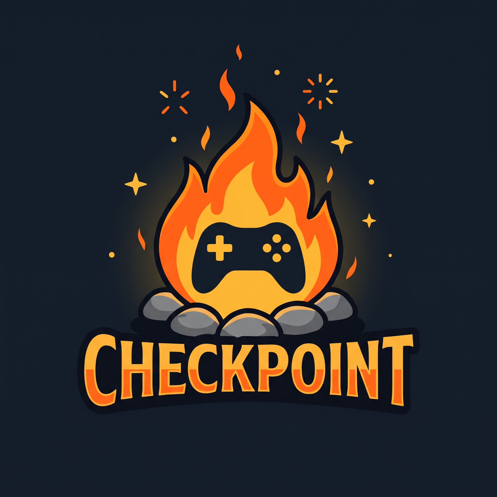

# 🔥 Checkpoint

**Sua jornada nos games, registrada.**

Uma rede social para quem ama jogar: descubra, registre, avalie e compartilhe os games que marcaram você.

---

## 🎮 O que é o Checkpoint?

Nos games, um *checkpoint* é aquele ponto da fogueira onde você salva o progresso, descansa e segue em frente. Esse é o espírito do projeto.

O **Checkpoint** é uma plataforma web social para gamers, inspirada no que o Letterboxd faz pelo cinema. Aqui você mantém o diário da sua vida gamer: o que jogou, o que achou, o que quer jogar e o que seus amigos estão jogando.

Para isso, usamos a **API da Steam** como porta de entrada para um catálogo enorme de jogos, sem precisar cadastrar tudo na mão.

## ✨ Ideia de funcionalidades

> O projeto está em fase inicial, então esta lista representa a visão e pode mudar ao longo do desenvolvimento.

- 📚 **Catálogo de jogos** alimentado pela API da Steam
- ⭐ **Avaliações e reviews** dos jogos que você jogou
- 📝 **Diário de jogos**: registre o que está jogando, zerou ou abandonou
- 🕹️ **Backlog e wishlist**: organize o que ainda quer jogar
- 👥 **Perfis e amigos**: siga outros jogadores e veja a atividade deles
- 📋 **Listas personalizadas**: monte e compartilhe suas listas temáticas

## 🧰 Stack

| Camada | Tecnologia |
| --- | --- |
| **Back-end** | C# com .NET 10 (Web API) |
| **Front-end** | React + Vite |
| **Dados de jogos** | Steam Web API |

## 🗂️ Repositórios

| Repositório | Descrição |
| --- | --- |
| [`Checkpoint-backend`](https://github.com/Checkpoint-site/Checkpoint-backend.git) | API em .NET 10 |
| [`Checkpoint-frontend`](https://github.com/Checkpoint-site/Checkpoint-frontend.git) | Front-end em React + Vite |

## 🤝 Como contribuir

Quer ajudar a acender essa fogueira? Siga os passos:

1. Dê uma olhada nas *issues* abertas nos repositórios
2. Faça um fork e crie uma branch para sua alteração
3. Abra um Pull Request explicando o que mudou e por quê

Sugestões e ideias também são bem-vindas, é só abrir uma issue.

## 👨‍💻 Time

<!-- Adicione os integrantes -->
- [@Diniz-Bruno](https://github.com/Diniz-Bruno)
- [@Pereira-Sousa](https://github.com/Pereira-Sousa)

---

🔥 *Descanse na fogueira. Salve seu progresso. Continue a jornada.*

